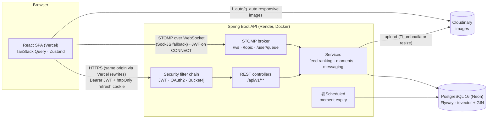
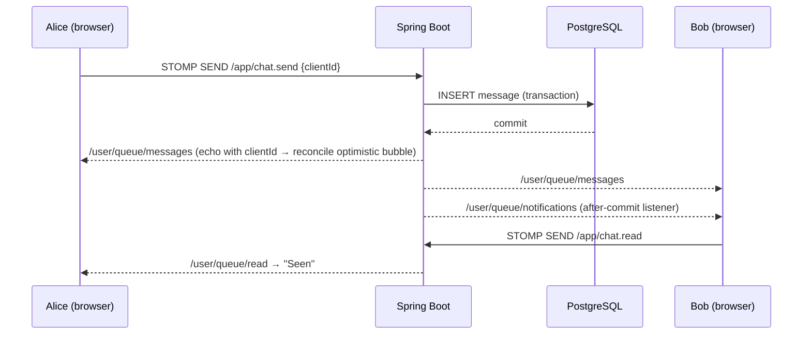

# ConnectHub

A social network built around **interests and moments**, not follower counts.

- **Circles** — small interest-based groups (max 150 members). Your feed is built from your circles. No public follower numbers anywhere.
- **Vibes** — five reactions (Spark ✦, Deep ◉, Funny ☺, Support ♥, Mind-blown ✶) shown as a colour-blended ring, never a number.
- **Moments** — 24-hour posts in a "Today" strip that move into a private **Rewind** archive.

Also: realtime 1:1 messaging (typing, read receipts, shared posts), live notifications, full-text search,
private profiles, blocking and reporting, a soft profanity filter, and light/dark themes. It's mobile-first
and fully responsive.

**Docs:** [DEPLOY.md](DEPLOY.md) (going live: Neon + Render + Vercel + Cloudinary) ·
[DECISIONS.md](DECISIONS.md) (120 engineering decisions and the reasons behind them) ·
Swagger UI at `/swagger-ui.html`.

## Monorepo

| Path | What |
| --- | --- |
| [`client/`](client) | React 18 + TypeScript + Vite, Tailwind v4, shadcn/ui-style components, TanStack Query, Zustand, Framer Motion |
| [`server/`](server) | Java 21, Spring Boot 3.3, Spring Security (JWT), WebSocket/STOMP, JPA + Flyway, PostgreSQL 16 |
| [`client/e2e/`](client/e2e) | Playwright end-to-end tests (sign-up → onboarding → post → react → DM) |
| [`docker-compose.yml`](docker-compose.yml) | Local Postgres 16 + API |
| [`render.yaml`](render.yaml) | Render blueprint for the API |
| [`.github/workflows/ci.yml`](.github/workflows/ci.yml) | Server tests, client build, then e2e against a real API on every push |

## Architecture



**Code layout.** The server is package-by-feature (`auth`, `user`, `circle`, `post`, `comment`, `feed`, `moment`,
`message`, `notification`, `search`, `moderation`, `storage`, plus `config` and `common`). Controllers are thin,
services hold the logic, and repositories are Spring Data. Cross-feature side effects (notifications) travel as
domain events handled **after commit**. The client is organised as `pages/`, `components/ui` (design system),
`components/feature`, `hooks/`, `stores/` (Zustand), `lib/` (typed API layer, query keys, realtime client)
and `routes/` (lazy, code-split routes with data prefetching).



## Local setup

**Prerequisites:** Java 21, Node 20+, Docker. Maven is not required (the repo ships `./mvnw`).

```bash
# 1. Database (and optionally the API) in Docker
docker compose up -d postgres          # or: docker compose up --build   (postgres + API)

# 2. API on :8080 (Flyway migrates on startup)
cd server && ./mvnw spring-boot:run

# 3. Web app on :5173
cd client && cp .env.example .env.local && npm install && npm run dev
```

- Swagger UI: http://localhost:8080/swagger-ui.html
- Health: http://localhost:8080/actuator/health
- Design system playground (dev only): http://localhost:5173/design

**Demo data** (dev profile): 20 users, 12 circles (3 private, with pending requests) ~80 posts with vibes, comments and replies, 30 moments (22 live, 8 in Rewind), and DMs and notifications for Maya. Accounts: `maya@connecthub.dev`, `theo@connecthub.dev`, … — password `Password123`.

> The client calls the API **same-origin**: Vite proxies `/api`, `/oauth2`, `/login/oauth2` and `/uploads` to `:8080`
> in dev, and `vercel.json` rewrites them to the backend in prod. This keeps the refresh cookie first-party
> (no third-party-cookie blocking in Safari/Chrome).

### Google sign-in (optional)

1. Google Cloud Console → APIs & Services → Credentials → *Create OAuth client ID* → Web application.
2. Authorized redirect URI: `http://localhost:5173/login/oauth2/code/google` (prod: `https://<vercel-domain>/login/oauth2/code/google`).
3. Put `GOOGLE_CLIENT_ID` and `GOOGLE_CLIENT_SECRET` in `server/.env` (or your shell) and restart the API.
   The "Continue with Google" button appears automatically once both are set.

Without Cloudinary credentials, uploaded images are stored in `server/uploads/` and served from `/uploads/**`.

### Tests

```bash
cd server && ./mvnw clean package   # 62 JUnit 5 tests on real PostgreSQL via Testcontainers (needs Docker)
cd client && npm run build          # strict TypeScript + production build
cd client && npm run e2e            # 5 Playwright flows (API + `npm run dev` running; dev profile seeds data)
```

| Suite | Covers |
| --- | --- |
| Server (62) | Auth and refresh rotation/reuse, Google OAuth (stateless), onboarding, uploads, circles (capacity, approvals, admin hand-over), posts, vibes, comments, **feed ranking and cursor paging**, moments and the expiry job, **messaging over REST and a real WebSocket**, notifications, full-text search, blocking, settings, account deletion, profanity |
| E2E (5) | Sign-up with validation · full onboarding (photo crop, interests, suggested circle) · post with photo + edit · vibes (set / change / remove) + comment + reply · two-browser DM (typing, live delivery, "Seen") |

### Performance and accessibility

Lighthouse (mobile emulation, cold cache) on the production build served with compression:

| Page | Performance | Accessibility | Best practices | SEO |
| --- | --- | --- | --- | --- |
| Sign in (first visit) | 93–94 | 100 | 100 | 100 |
| Home feed (signed in) | 86 | 100 | 100 | 100 |
| Messages / circle / profile | 78–87 | 100 | 100 | 100 |

What got it there: route-level code splitting, with the entry at 43 KB gzipped. The session restore and each page's data
prefetch start in parallel with chunk downloads. Composers, the moment viewer and the realtime client load
on demand. Fonts load without blocking paint, with metric-matched fallbacks (CLS 0). There's a static splash in the HTML,
priority hero images, and Cloudinary `f_auto,q_auto` responsive images. Signed-in pages need two API round trips
(session, then data) before first content, which is the remaining gap to 90 on throttled mobile. That's the
trade-off of a pure SPA versus SSR. Re-measure on the deployed site: Vercel adds HTTP/2 and an edge CDN.

### Regenerating API types

With the API running: `cd client && npm run gen:api` writes `src/types/openapi.d.ts` from `/v3/api-docs`.

## Environment variables

**Server** ([`server/.env.example`](server/.env.example)). Everything has a dev default in `application.yml` except
`JWT_SECRET` in the `prod` profile, which must be set.

| Variable | Purpose |
| --- | --- |
| `SPRING_PROFILES_ACTIVE` | `dev` (seed data, relaxed rate limits), `prod`, or `prod,demo` (prod + seed data) |
| `DATABASE_URL` · `DATABASE_USERNAME` · `DATABASE_PASSWORD` | JDBC PostgreSQL connection (`…?sslmode=require` on Neon) |
| `JWT_SECRET` | Base64, ≥ 32 bytes (`openssl rand -base64 48`) |
| `JWT_ACCESS_TTL_MINUTES` · `JWT_REFRESH_TTL_DAYS` | Token lifetimes (15 min / 7 days) |
| `COOKIE_SECURE` · `COOKIE_SAME_SITE` | Refresh-cookie flags (`true` / `Lax` in prod) |
| `CORS_ALLOWED_ORIGINS` · `FRONTEND_URL` | The SPA's origin(s), for CORS and the WebSocket handshake / OAuth redirects |
| `CLOUDINARY_CLOUD_NAME` · `CLOUDINARY_API_KEY` · `CLOUDINARY_API_SECRET` | Image storage (local disk fallback when unset) |
| `GOOGLE_CLIENT_ID` · `GOOGLE_CLIENT_SECRET` · `GOOGLE_REDIRECT_URI` | Optional Google sign-in |
| `RATE_LIMIT_MULTIPLIER` | Scales all rate limits (1 in prod; 25 in dev) |
| `DB_POOL_SIZE` · `PORT` · `UPLOAD_DIR` | Pool size, HTTP port, local upload folder |

**Client** ([`client/.env.example`](client/.env.example))

| Variable | Purpose |
| --- | --- |
| `VITE_API_URL` | Leave empty: the API is reached same-origin (Vite proxy in dev, Vercel rewrites in prod) |
| `VITE_WS_URL` | WebSocket endpoint: `http://localhost:8080/ws` in dev, `https://<render-service>/ws` in prod |

## Deployment

See **[DEPLOY.md](DEPLOY.md)** for step-by-step instructions (Neon → Render via `render.yaml` → Vercel → Google OAuth).

## API conventions

- Base path `/api/v1`. Every response: `{ "success": bool, "data": T|null, "error": {code, message, fields?}|null, "timestamp": ISO-8601 }`.
- Lists use keyset pagination: `?cursor=<createdAt>,<id>&limit=20` → `{ items, nextCursor }`.
- Public (no auth): `/api/v1/auth/**`, `GET` profile and circle reads, `/actuator/health`, Swagger.

### Endpoints

All paths are under `/api/v1`. The full, live spec is at `/swagger-ui.html`, and TypeScript types are generated from it
(`npm run gen:api`).

| Method | Path | Auth | Purpose |
| --- | --- | --- | --- |
| POST | `/auth/register` | – | Create account → `{ accessToken, expiresIn, user }` + `ch_rt` refresh cookie |
| POST | `/auth/login` | – | Email + password sign-in (rate-limited 10 / 5 min / IP) |
| POST | `/auth/refresh` | cookie | Rotate refresh cookie, return new access token |
| POST | `/auth/logout` | cookie | Revoke refresh token, clear cookie |
| GET | `/auth/providers` | – | `{ password, google }` sign-in methods available |
| GET | `/oauth2/authorization/google` | – | Start Google sign-in (browser navigation) |
| GET | `/interests` | – | All interests |
| GET | `/me` | ✓ | Current account |
| GET | `/me/username-availability?username=` | ✓ | `{ available, reason: TAKEN \| RESERVED \| INVALID }` |
| PUT | `/me/username` | ✓ | Claim username |
| POST | `/me/avatar` | ✓ | Multipart `file`; validated, cropped 400×400, EXIF stripped |
| PUT | `/me/interests` | ✓ | 3–10 interest ids |
| POST | `/me/onboarding/complete` | ✓ | Requires username + ≥ 3 interests |
| PATCH | `/me/profile` | ✓ | Display name, bio (160), location, website |
| POST / DELETE | `/me/cover` | ✓ | Upload (1500×500) / remove profile cover |
| GET | `/me/circles` | ✓ | Circles you're active in |
| GET | `/me/circle-suggestions?limit=` | ✓ | Interest-matched circles, topped up with trending |
| GET | `/users/{username}` | – | Public profile (`restricted` when private and you share no circle) |
| GET | `/users/{username}/circles` | – | Their circles (private ones only to co-members) |
| GET | `/circles?category=&q=&page=&size=` | – | Browse / search, largest first |
| GET | `/circles/discover/trending?limit=` | – | Momentum (joins in 7 days ×3) + size |
| POST | `/circles` | ✓ | Create (you become admin); 5/hour |
| GET | `/circles/{slug}` | – | Detail incl. your membership, admins, pending count (admins) |
| PATCH | `/circles/{slug}` | admin | Edit name, description, category, privacy, member limit |
| POST | `/circles/{slug}/cover` | admin | Cover image (1200×400) |
| POST | `/circles/{slug}/join` | ✓ | Join (public) or request (private); 409 when full |
| DELETE | `/circles/{slug}/membership` | ✓ | Leave or withdraw a request |
| GET | `/circles/{slug}/members?status=active\|pending` | –/admin | Members (public circles or members) / requests (admins) |
| POST | `/circles/{slug}/members/{userId}/approve` | admin | Approve a request |
| DELETE | `/circles/{slug}/members/{userId}` | admin | Remove a member or decline a request |
| PUT / DELETE | `/circles/{slug}/pin` | admin | Pin `{ postId }` / unpin |
| GET | `/feed?cursor=&limit=` | ✓ | Ranked home feed from your circles (cursor = `<rankTime>,<id>`) |
| GET | `/circles/{slug}/posts?cursor=` | – | Circle timeline, newest first |
| GET | `/users/{username}/posts?cursor=` | – | A user's posts in circles you can read |
| GET | `/me/saved?cursor=` | ✓ | Saved posts |
| POST | `/posts` | ✓ | Multipart: `post` (JSON `{ circleId, content }`) + up to 4 `images`; 10 / 15 min |
| GET | `/posts/{id}` | – | One post (404 if in a private circle you're not in) |
| PATCH | `/posts/{id}` | author | Edit text within 15 minutes |
| DELETE | `/posts/{id}` | author/admin | Delete |
| PUT / DELETE | `/posts/{id}/reaction` | ✓ | Set `{ type: spark\|deep\|funny\|support\|mindblown }` / remove → `{ vibe, myReaction }` |
| PUT / DELETE | `/posts/{id}/save` | ✓ | Save / unsave |
| POST | `/posts/{id}/report` | ✓ | `{ reason, details? }` |
| GET / POST | `/posts/{id}/comments` | –/✓ | List (oldest first, with replies) / create `{ content, parentId? }` |
| DELETE | `/comments/{id}` | ✓ | Comment author, post author or circle admin |
| PUT / DELETE | `/comments/{id}/reaction` | ✓ | Vibe on a comment |
| POST | `/moments` | ✓ | Multipart: `moment` (JSON `{ kind: text\|image, text?, background? }`) + `image`; live 24h |
| GET | `/moments/strip` | ✓ | Live moments from you + people sharing a circle with you, grouped by person |
| POST | `/moments/{id}/view` | ✓ | Mark seen (counted once; count visible only to the author) |
| DELETE | `/moments/{id}` | author | Delete |
| GET | `/me/rewind?cursor=` | ✓ | Your archived moments (private) |
| GET | `/me/contacts?q=` | ✓ | People sharing a circle with you |
| GET / POST | `/conversations` | ✓ | List (cursor) / open-or-create 1:1 `{ userId }` (circle-mates only) |
| GET | `/conversations/unread-count` | ✓ | Conversations with unread messages |
| GET | `/conversations/{id}/messages?cursor=` | ✓ | History, newest first |
| POST | `/conversations/{id}/messages` | ✓ | Send `{ content?, sharedPostId?, clientId? }` (REST fallback); 60 / min |
| POST | `/conversations/{id}/read` | ✓ | Mark read → read receipt to the other person |
| GET | `/notifications?cursor=` · `/notifications/unread-count` | ✓ | Notification centre and bell badge |
| POST | `/notifications/{id}/read` · `/notifications/read-all` | ✓ | Mark read |
| GET | `/search?q=&type=all\|people\|circles\|posts` | ✓ | Full-text, prefix-matched, ranked; respects privacy and blocks |
| PATCH | `/me/settings` | ✓ | `{ privateProfile?, notificationPrefs? }` |
| PUT | `/me/email` | ✓ | `{ email, currentPassword }` |
| PUT | `/me/password` | ✓ | `{ currentPassword?, newPassword }`: signs out other sessions, returns a fresh one |
| DELETE | `/me` | ✓ | `{ password }` or `{ confirm: "DELETE" }` (Google-only accounts) |
| GET | `/me/blocks` | ✓ | People you've blocked |
| POST / DELETE | `/users/{username}/block` | ✓ | Block / unblock |
| POST | `/users/{username}/report` · `/comments/{id}/report` | ✓ | `{ reason, details? }` |

### Realtime (STOMP at `/ws`: native WebSocket at `/ws/websocket`, SockJS fallback)

Connect with the STOMP header `Authorization: Bearer <accessToken>`. Clients can only subscribe to their own queues.

| Direction | Destination | Payload |
| --- | --- | --- |
| send | `/app/chat.send` | `{ conversationId, content?, sharedPostId?, clientId? }` |
| send | `/app/chat.typing` | `{ conversationId, typing }` |
| send | `/app/chat.read` | `{ conversationId }` |
| receive | `/user/queue/messages` | `MessageDto` (both participants; `clientId` echoed to the sender only) |
| receive | `/user/queue/read` | `{ conversationId, readerId, readAt }` |
| receive | `/user/queue/typing` | `{ conversationId, userId, typing }` |
| receive | `/user/queue/notifications` | `NotificationDto` |
| receive | `/user/queue/errors` | `{ success: false, error: { code, message, fields: { clientId } } }` |

